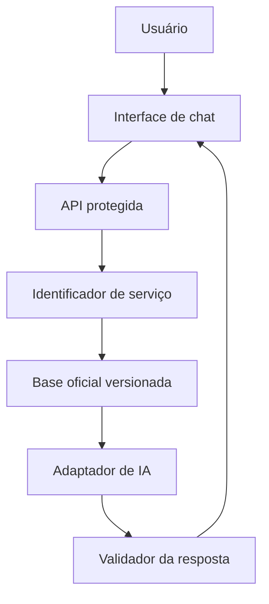

# Arquitetura do MVP

## Visão geral



## Componentes

| Componente | Responsabilidade |
|---|---|
| Interface | Exibir conversa, fontes e checklist; manter somente o estado da sessão. |
| API | Validar entrada, limitar requisições, orquestrar consulta e ocultar a chave. |
| Registro de serviços | Relacionar identificadores, nomes, siglas, termos equivalentes e pastas de conteúdo. |
| Base oficial | Armazenar roteiro, documentos, perguntas frequentes e fontes validadas. |
| Adaptador de IA | Encapsular a chamada ao Gemini e permitir troca futura de provedor. |
| Validador | Rejeitar resposta sem fonte, serviço ou suporte nos trechos recuperados. |

## Fluxo da resposta

1. A API recebe a mensagem e um histórico curto da sessão.
2. Valida tamanho e formato da entrada.
3. Identifica o serviço por termos cadastrados e, quando necessário, com classificação da IA.
4. Recupera somente o conteúdo validado do serviço.
5. Monta uma instrução com a pergunta, os trechos e as regras do assistente.
6. O provedor gera uma resposta estruturada.
7. O servidor valida serviço, fontes e tipo de resposta.
8. A interface exibe o texto, as fontes e, quando solicitado, o checklist.

## Contrato inicial da API

### `POST /api/chat`

Entrada:

```json
{
  "message": "Quero saber como solicitar uma LAC",
  "history": []
}
```

Saída:

```json
{
  "status": "answered",
  "serviceId": "lac",
  "answer": "...",
  "sources": [],
  "checklistAvailable": true
}
```

Estados previstos: `answered`, `clarification_needed`, `not_available` e `error`.

## Estrutura da base

```text
services/
├── registry.json
├── schemas/
│   ├── registry.schema.json
│   └── service.schema.json
└── lac/
    └── versoes/
        └── v1/
            ├── versao.json
            ├── service.json
            ├── roteiro.md
            ├── documentos.json
            ├── perguntas-frequentes.json
            ├── fontes.json
            └── conteudo-assistente.json
```

### Como a base é organizada

- **Registro central:** `registry.json` lista os serviços (identificador, `assuntoId`, `versaoAtualId`, `versaoPublicadaId`, caminho do `service.json` da versão atual, status e publicação).
- **Arquivos por serviço e por versão (Passo 7C2):** cada serviço tem pasta própria e o conteúdo fica na pasta da versão, `services/<id>/versoes/v<número>/`, em arquivos modulares separados (dados, roteiro, documentos, perguntas frequentes, fontes e conteúdo do assistente), mais o manifesto `versao.json`. O conteúdo não é reunido em um único JSON, e nada fica solto na raiz de `services/<id>/`. A LAC tem só a versão 1 (`lac-v1`), em **rascunho**, migrada sem alteração material, sem hash, sem envio, sem decisão e sem versão publicada (`versaoPublicadaId: null`). O validador confere versão atual existente, `servicoId`, id e número coerentes, caminhos dentro da pasta da versão, arquivos existentes, ausência de arquivos soltos ou de pastas de versão não registradas e que `versaoPublicadaId` só aponte para versão em estado publicado. O assistente em teste local (`services/assistant-endpoint.js`) localiza a versão atual pelo registro e pelo manifesto (`services/versao-atual.js`), sem caminho fixo da LAC. Os status atuais de serviço, fontes, documentos e perguntas não mudaram.
- **Relação por `fonteId`:** documentos e perguntas apontam para uma fonte de `fontes.json` pelo `fonteId`; `links` e `legislacao` do `service.json` listam identificadores de fontes.
- **Tipos de links oficiais:** `legislacao`, `pagina_oficial`, `manual`, `formulario`, `sistema`, `canal_atendimento` e `outro`.
- **HTTPS:** toda URL cadastrada deve usar `https://` e não pode se repetir.
- **Sem acesso automático:** `npm run validate:services` confere apenas o formato; nenhum link é acessado nem baixado.
- **Bloqueio de conteúdo:** serviço ou fonte em `rascunho` ou `em_validacao` não pode ser publicado, e em `rascunho` o conteúdo material fica `PENDENTE`.
- **Origem oficial não é validação:** cada fonte tem `origemOficial` (a fonte pertence a órgão público ou instituição oficial), `statusValidacao` (`rascunho`, `em_validacao` ou `validado`) e `publicado`. Uma fonte oficial em `em_validacao` continua sem poder orientar respostas; `publicado` só pode ser `true` com status `validado`.
- **Vigência jurídica:** cada fonte tem `vigencia` com `situacao` (`vigente`, `alterada`, `revogada`, `a_confirmar` ou `nao_se_aplica`), `normasRelacionadas` (ids de fontes do mesmo `fontes.json`) e `observacao`. Legislação não usa `nao_se_aplica`; as demais fontes usam somente `nao_se_aplica`; norma `revogada` cita ao menos uma norma relacionada.
- **Normas revogadas:** podem ficar registradas como histórico, mas nunca podem ser publicadas nem orientar respostas. Norma com vigência `a_confirmar` também não pode ser publicada. Um serviço publicado só pode referenciar fontes validadas, publicadas e não revogadas.
- **Validar a fonte não é publicar:** `statusValidacao: validado` em uma fonte significa que ela foi localizada, pertence ao órgão indicado e teve título, URL e metadados conferidos. Não confirma vigência, atualização do conteúdo nem autorização para responder ao cidadão; por isso as fontes validadas continuam com `publicado: false`. O conjunto `fontes.json` permanece `em_validacao`, pois ainda pode receber novas fontes.
- **Fontes documentais e normas:** manuais, termos de referência e perguntas e respostas ficam em `links` do serviço, nunca em `legislacao`. Uma fonte não legislativa mantém `vigencia.situacao: nao_se_aplica` e pode citar em `normasRelacionadas` apenas fontes do tipo `legislacao` existentes no mesmo arquivo.
- **Serviço em validação:** com `statusValidacao: em_validacao`, o serviço pode ter conteúdo cadastrado, mas continua `publicado: false`. Todo campo preenchido (`descricao`, `publico`, `condicoes`, `etapas`, `sistemaInicio`, `canalAtendimento`) indica suas fontes em `referencias` por `fonteId`, e cada seção do `roteiro.md` com conteúdo traz uma linha `Fontes:` com ids existentes. Fonte revogada não pode ser citada como fundamento.
- **Checklist de documentos:** os 28 itens de `documentos.json` foram transcritos do TR nº 176 (2020), com `fonteId`, `localizacaoFonte` (numeração do TR), `aplicabilidade` e `condicional`. Todos estão `em_validacao`, `publicado: false` e `revisaoAtualidade: pendente`. `obrigatorio: null` significa que a obrigatoriedade atual **não foi confirmada** (não é dispensa); `true` ou `false` só são aceitos após revisão de atualidade concluída e validação. `condicional` reflete a condição descrita no TR de 2020, e não uma confirmação atual: `condicional: false` significa apenas que o TR não apresentou condição expressa naquele item, sem confirmar que o documento seja hoje obrigatório (isso é representado por `obrigatorio`). Inconsistências e possíveis sinais de desatualização do TR ficam em `alertas`, campo sempre presente: lista vazia quando não há inconsistência específica e, quando há problema identificado, um ou mais textos não vazios. O conteúdo não está disponível ao assistente: só item publicado, validado, com revisão concluída e fonte publicada e não revogada passa pelo filtro.
- **Perguntas frequentes:** as 21 perguntas de `perguntas-frequentes.json` foram transcritas do FAQ de 2022 em linguagem de fonte histórica ("O FAQ de 2022 informa que…"). `conteudoFonte` é só registro da fonte e **nunca** é usado pelo assistente; somente `respostaPublicavel`, aprovada e publicada, poderá ser usada. Todas estão `em_validacao`, `publicado: false`, `revisaoAtualidade: pendente` e `respostaPublicavel: null`. `bloqueios` usa valores controlados (desatualizacao, vigencia, informacao_variavel, fonte_complementar, conflito_com_base, contato_desatualizado, procedimento_do_sistema, enquadramento_dependente_de_analise); pergunta publicada não pode ter bloqueios. Contatos (e-mails e telefones) não são armazenados: o validador rejeita esses dados e o FAQ registra apenas que há um contato institucional a atualizar. As observações a até h do FAQ não foram cadastradas e ficam para a revisão do Passo 4.
- **Conteúdo do assistente por ambiente:** `conteudo-assistente.json` guarda blocos de conteúdo, cada um com `ambiente` (`teste_local` ou `publico`), `origem` (`fonte` ou `regra_institucional`) e as mesmas marcas de validação e publicação. O teste local é uma condição **separada** de `publicado`: bloco `teste_local` nunca é `publicado: true` nem `validado`, e a autorização de teste (`autorizacao`, escopo `teste_local`, `aprovacaoMaterial: false`, `aprovacaoPublica: false`) não é aprovação material nem pública. O validador impede, em bloco de teste, valores, prazos, validade, normas, obrigatoriedade documental, canal de protocolo e contatos.
- **Seleção por modo:** a função pura `selecionarBlocosAssistente(dados, modo)` (`services/assistant-content.js`) recebe os dados e o modo explicitamente. O modo padrão é `publico`: só entrega bloco publicado, validado, com revisão concluída e fontes publicadas e não revogadas, o que hoje resulta em zero blocos. O modo `teste_local` entrega somente os blocos de teste, e apenas com autorização válida. Modo desconhecido é rejeitado. A função não lê arquivos nem variáveis de ambiente. Documentos e perguntas não passam por ela.
- **Assistente em teste local (Passo 6):** o endpoint `GET /__assistente/blocos` (`services/assistant-endpoint.js`, registrado em `vite.config.js` com `apply: 'serve'`) existe somente no servidor de desenvolvimento. Ele usa `selecionarBlocosAssistente(..., 'teste_local')` com o modo fixo no servidor, aceita só `GET`, só de origem local, recusa qualquer parâmetro e não recebe nem repete a pergunta. Entrega os blocos, as fontes (somente `https`) e as mensagens fixas (`services/assistant-messages.js`: faixa de teste e frase de escopo), que ficam no servidor e não no código da interface. A interface (`src/main.js`) busca o endpoint só quando `import.meta.env.DEV` é verdadeiro, valida a resposta (`validarPayload`) e usa `src/assistant.js` para reconhecer a intenção e montar a resposta **no navegador, palavra por palavra a partir dos blocos**. Sem blocos, a resposta é a mensagem segura de indisponibilidade. O DOM é montado com `textContent` (sem `innerHTML`), links só `https`, e a conversa fica em memória, sem gravação no navegador. `scripts/check-dist.js` confere que o build não contém blocos, frase de escopo, faixa nem nomes internos. Uma IA externa, no futuro, só poderia rodar no servidor, com a chave em variável de ambiente do servidor, recebendo apenas os blocos selecionados e com a saída validada.
- **Assunto e serviço (Marco 7, Passo 7A):** são conceitos distintos. **Assunto** é uma área ampla da SEMA e fica em `services/assuntos.json` (esquema `schemas/assuntos.schema.json`); **serviço** é um atendimento específico e continua cadastrado em `services/registry.json` e em `services/<id>/service.json`, com `assuntoId` apontando para um assunto **existente e ativo**. O `assuntoId` precisa ser igual no registro e no `service.json`. Hoje há um assunto, "Licenciamento Ambiental", e a LAC está vinculada a ele. O campo `categoria` do serviço segue como texto livre.
- **Fluxo de versões (modelo, ainda não aplicado):** `services/admin/fluxo.js` define os seis estados que pertencem à **versão** de um serviço (`rascunho`, `em_validacao`, `ajustes_solicitados`, `validado_materialmente`, `autorizado_publicacao`, `publicado`) e as transições válidas, em funções puras. `services/admin/hash.js` calcula o SHA-256 determinístico do conteúdo (chaves normalizadas), para provar qual conteúdo foi validado. **O fluxo ainda não foi aplicado à LAC**: os status atuais de serviço, fontes, documentos e perguntas (`rascunho`, `em_validacao`, `validado`) não mudaram, o conteúdo da LAC não foi migrado para versões, e **não há validação material nem publicação autorizada**. Não existe interface, endpoint nem armazenamento administrativo nesta fase.
- **Versões e decisões (Passo 7B, funções puras):** `services/admin/versao.js` e `services/admin/decisoes.js` implementam o fluxo da versão sobre `fluxo.js` e `hash.js`. A versão guarda só **referências** aos arquivos modulares (`arquivos`), mais `estado`, `numero`, `baseadaEm`, `hashConteudo`, `criadoEm` e `enviadaEm`; o conteúdo é entregue apenas para calcular o hash. Regras: enviar para validação calcula o hash; a decisão material (`ajustes_solicitados`, com observação obrigatória, ou `validado_materialmente`) exige o mesmo `versaoId` e o mesmo hash; a autorização de publicação é uma decisão separada, só depois da validação material do mesmo hash; a publicação só depois da autorização do mesmo hash; a partir de `em_validacao` a versão fica congelada; nova versão (rascunho, número seguinte, `baseadaEm`) só a partir de ajustes, validada, autorizada ou publicada, preservando a anterior. O histórico só recebe acréscimos (sem editar, apagar ou reordenar) e recusa id duplicado. Ids e datas vêm de fora das funções, e os objetos recebidos nunca são modificados. Esquemas: `schemas/versao.schema.json`, `schemas/decisao-material.schema.json` e `schemas/autorizacao-publicacao.schema.json`. **Nenhuma versão, decisão ou validação material real foi registrada**; `responsavel` e `unidade` são identificadores de registro, sem valor de comprovação de identidade, e decisões com identificação pessoal continuarão fora do Git. Ainda não há migração da LAC, armazenamento, endpoint nem interface.
- **Armazenamento local (Passo 7C1):** `services/admin/armazenamento.js` lê JSON, grava JSON de forma atômica, acrescenta registros a um histórico JSONL e o lista, dentro de uma raiz recebida explicitamente. Valida os dados com função do chamador antes de gravar, usa formato determinístico (UTF-8, chaves ordenadas, quebra de linha final) e recusa caminho absoluto, `..`, byte nulo, saída da raiz, links simbólicos, extensões não permitidas e id duplicado; o histórico só aceita acréscimos. Não usa `localStorage`, rede nem variáveis de ambiente, e **ainda não é usado por nenhum endpoint ou interface**. Os dados privados ficarão em `data/admin-private/`, no `.gitignore`. Detalhes e limites (sem autenticação, sem comprovação de identidade) em [ADMINISTRACAO.md](ADMINISTRACAO.md).
- **Endpoint administrativo local de leitura (Passo 7D):** `services/admin/admin-endpoint.js`, registrado em `vite.config.js` com `apply: 'serve'` (só no `npm run dev`; não existe no build nem no preview). Rotas `GET /__admin/sessao`, `/__admin/catalogo` e `/__admin/servicos/<id>/versao-atual`, com token em memória (`node:crypto`) no cabeçalho `X-Admin-Token`, validação de conexão local, `Host` e `Origin`, sem CORS, `Cache-Control: no-store`, só `GET`, sem query nem corpo, erros genéricos e limite de resposta. Reutiliza `armazenamento.js` e `versao-atual.js`, não grava nada e não lê dados privados. O `check-dist` passou a procurar nomes e conteúdo administrativos no `dist/`. Ainda não há interface administrativa. Detalhes em [ADMINISTRACAO.md](ADMINISTRACAO.md).
- **Cadastro administrativo (Passo 7E1):** `POST /__admin/assuntos` e `POST /__admin/servicos` no mesmo endpoint de desenvolvimento, com token, origem local, `Content-Type: application/json`, corpo de até 32 KB e somente os campos permitidos. Funções puras (`services/admin/cadastro.js`) montam o assunto e o esqueleto do serviço (versão 1, rascunho, não publicado, tudo `PENDENTE`, sem conteúdo inventado); `services/admin/transacao.js` aplica a alteração como uma só (ensaio em cópia temporária, escrita atômica pelo armazenamento, conferência pelo validador e desfazer integral em caso de falha). Uma gravação por vez (409 se houver outra em andamento). O `armazenamento.js` ganhou `lerTexto` e `gravarTexto` para `.md`. Ainda não há interface, edição, decisão, publicação nem exclusão. Detalhes em [ADMINISTRACAO.md](ADMINISTRACAO.md).
- **Interface administrativa (Passo 7E2):** a pasta `admin/` (`index.html`, `styles.css`, `admin.js` e `admin-logic.js`) é a tela "Gestão de conteúdo", servida pelo Vite só em desenvolvimento (`http://localhost:5173/admin/`; um plugin com `apply: 'serve'` redireciona `/admin`). O build usa apenas o `index.html` da raiz, então `admin/` não entra no `dist/`, e `check-dist` confere isso. `admin-logic.js` concentra as funções puras (validação dos formulários, agrupamento do catálogo, mensagens de erro) e um cliente do endpoint com `fetch` injetável, que guarda o token só em memória e impede envio duplicado; `admin.js` apenas liga isso ao DOM, sem `innerHTML` nem armazenamento do navegador. A interface do cidadão não referencia a administração. Detalhes em [ADMINISTRACAO.md](ADMINISTRACAO.md).
- **Cadastro de fontes por serviço (Passo 7E3A):** `POST /__admin/servicos/<id>/fontes` acrescenta uma fonte ao arquivo de fontes da versão atual, só quando ela está em `rascunho` e com revisão otimista: `GET .../versao-atual` devolve `revisaoFontes` (SHA-256 do conteúdo) e o `POST` a exige (409 se divergir). Campos de status, publicação, data de consulta e vigência são definidos pelo servidor: a fonte nasce em rascunho, não publicada, com vigência `a_confirmar` (legislação) ou `nao_se_aplica`. Reaproveita a transação (ensaio, escrita atômica, conferência, desfazer) e a trava de escrita. A tela ganhou a seção "Fontes do serviço", sem editar, excluir, validar ou publicar. Detalhes em [ADMINISTRACAO.md](ADMINISTRACAO.md).
- **Cadastro simplificado (Passo 7E3B):** o id de assunto e de serviço é gerado pelo servidor a partir do nome (`baseDoId` e `gerarId`, em `services/admin/cadastro.js`: minúsculas, sem acentos, hífen, começando por letra, com prefixo `item-` se começar por número), uma única vez, com colisão resolvida por sufixo determinístico (`-2`, `-3`...) sem sobrescrever registros. O cliente não envia id (campo extra, 422). A tela não mostra ids nem ids de versão: o catálogo de exibição (`agruparCatalogo`) traz só nome, descrição, sigla, situação amigável e publicação. A estrutura técnica (ids, versões, hashes, caminhos) segue nos arquivos internos e na API de consulta. Dados existentes inalterados.
- **Saúde do sistema (Passo 8B):** `GET /__admin/saude` (só no servidor de desenvolvimento, com as proteções do endpoint administrativo) executa `verificarSaude` (`services/admin/saude.js`) e devolve, por componente, capacidade (`implementado`, `nao_implementado`, `nao_se_aplica`) e estado (`operacional`, `degradado`, `indisponivel`, `nao_verificado`) separados, com horário ISO e mensagem pública fixa. As verificações são reais: aplicação, base (validador), armazenamento (teste temporário fora dos dados reais) e contagem de conteúdo publicado; banco, IA externa e processamento de fontes constam como não implementados (MCP não faz parte da saúde operacional). O resumo conta os estados só entre os componentes implementados e traz a contagem separada de não implementados. A interface é a página `/admin/saude/` (`admin/saude/`), separada de `/admin/`, que reutiliza a lógica e o token de `admin/admin-logic.js`. Nada disso entra no build. Detalhes em [ADMINISTRACAO.md](ADMINISTRACAO.md).
- **Testes de ponta a ponta (Passo 8C):** `e2e/` e `playwright.config.js` (`@playwright/test`, devDependency, só Chromium) executam 13 testes somente leitura contra o servidor de desenvolvimento (porta 5173 estrita, sem `--host`), com bloqueio de requisições que não sejam GET e de rede externa. A gestão de conteúdo (`/admin/`) e a saúde (`/admin/saude/`) são páginas separadas; recursos não implementados (banco, IA externa, processamento de fontes) são apresentados como não implementados, não como falhas. `e2e/`, `playwright-report/` e `test-results/` não entram no build.
- **Uso pelo assistente:** somente fontes validadas e publicadas poderão ser utilizadas. O registro da situação de vigência não substitui a conferência pela área competente.
- **Novos serviços:** entram pelo mesmo caminho, com uma pasta em `services/` e uma entrada no registro, sem alterar o fluxo principal.

## Decisões de segurança

- `GEMINI_API_KEY` existe somente no ambiente da função serverless;
- nenhuma chamada direta ao Gemini parte do navegador;
- mensagens e histórico não são gravados;
- logs não devem registrar o conteúdo integral da conversa;
- erros públicos não exibem prompt, chave, resposta bruta ou detalhes internos;
- apenas conteúdo `validado` participa da recuperação;
- limites de tamanho e frequência serão aplicados na API.

## Evolução

Novos serviços serão incluídos no registro e em pastas próprias. Banco de dados, busca vetorial, autenticação e integrações institucionais só serão avaliados depois que o MVP comprovar a necessidade.

## MCP local de consulta da base (Sprint 2)

Ferramenta de apoio ao desenvolvimento, fora da aplicação: `.mcp.json` inicia `scripts/mcp/` (`npm run mcp`), com quatro ferramentas somente leitura (`listar_assuntos`, `listar_servicos`, `consultar_fontes`, `resumir_base`) sobre a base em `services/`. Não é endpoint do chat, não consta da saúde do sistema, não existe no `dist/` e não torna o conteúdo da LAC público. Evidências em `docs/EVIDENCIAS_MCP.md`.
