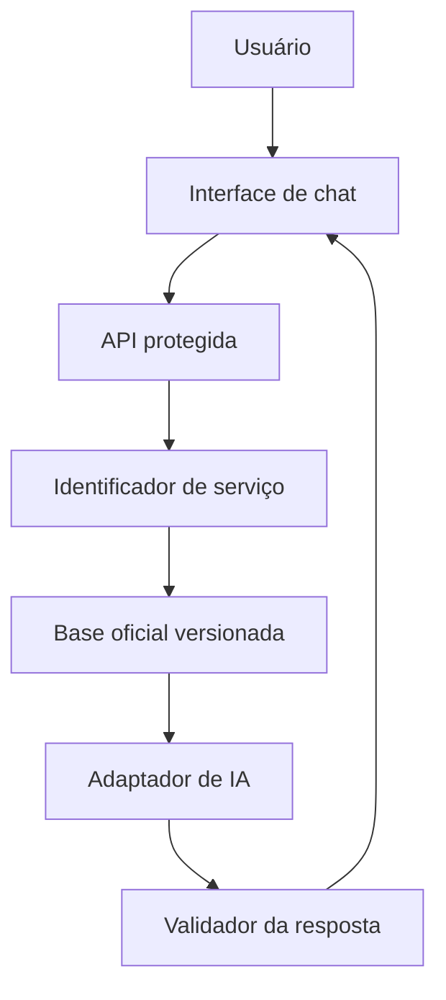

# Arquitetura do MVP

## Visão geral



## Componentes

| Componente | Responsabilidade |
|---|---|
| Interface | Exibir conversa, fontes e checklist; manter somente o estado da sessão. |
| API | Validar entrada, limitar requisições, orquestrar consulta e ocultar a chave. |
| Registro de serviços | Relacionar identificadores, nomes, siglas, termos equivalentes e pastas de conteúdo. |
| Base oficial | Armazenar roteiro, documentos, perguntas frequentes e fontes validadas. |
| Adaptador de IA | Encapsular a chamada ao Gemini e permitir troca futura de provedor. |
| Validador | Rejeitar resposta sem fonte, serviço ou suporte nos trechos recuperados. |

## Fluxo da resposta

1. A API recebe a mensagem e um histórico curto da sessão.
2. Valida tamanho e formato da entrada.
3. Identifica o serviço por termos cadastrados e, quando necessário, com classificação da IA.
4. Recupera somente o conteúdo validado do serviço.
5. Monta uma instrução com a pergunta, os trechos e as regras do assistente.
6. O provedor gera uma resposta estruturada.
7. O servidor valida serviço, fontes e tipo de resposta.
8. A interface exibe o texto, as fontes e, quando solicitado, o checklist.

## Contrato inicial da API

### `POST /api/chat`

Entrada:

```json
{
  "message": "Quero saber como solicitar uma LAC",
  "history": []
}
```

Saída:

```json
{
  "status": "answered",
  "serviceId": "lac",
  "answer": "...",
  "sources": [],
  "checklistAvailable": true
}
```

Estados previstos: `answered`, `clarification_needed`, `not_available` e `error`.

## Estrutura da base

```text
services/
├── registry.json
├── schemas/
│   ├── registry.schema.json
│   └── service.schema.json
└── lac/
    ├── service.json
    ├── roteiro.md
    ├── documentos.json
    ├── perguntas-frequentes.json
    └── fontes.json
```

### Como a base é organizada

- **Registro central:** `registry.json` lista os serviços (identificador, caminho do `service.json`, status e publicação).
- **Arquivos por serviço:** cada serviço tem pasta própria, com dados, roteiro, documentos, perguntas frequentes e fontes em arquivos separados.
- **Relação por `fonteId`:** documentos e perguntas apontam para uma fonte de `fontes.json` pelo `fonteId`; `links` e `legislacao` do `service.json` listam identificadores de fontes.
- **Tipos de links oficiais:** `legislacao`, `pagina_oficial`, `manual`, `formulario`, `sistema`, `canal_atendimento` e `outro`.
- **HTTPS:** toda URL cadastrada deve usar `https://` e não pode se repetir.
- **Sem acesso automático:** `npm run validate:services` confere apenas o formato; nenhum link é acessado nem baixado.
- **Bloqueio de conteúdo:** serviço ou fonte em `rascunho` ou `em_validacao` não pode ser publicado nem apresentado como oficial, e em `rascunho` o conteúdo material fica `PENDENTE`.
- **Novos serviços:** entram pelo mesmo caminho, com uma pasta em `services/` e uma entrada no registro, sem alterar o fluxo principal.

## Decisões de segurança

- `GEMINI_API_KEY` existe somente no ambiente da função serverless;
- nenhuma chamada direta ao Gemini parte do navegador;
- mensagens e histórico não são gravados;
- logs não devem registrar o conteúdo integral da conversa;
- erros públicos não exibem prompt, chave, resposta bruta ou detalhes internos;
- apenas conteúdo `validado` participa da recuperação;
- limites de tamanho e frequência serão aplicados na API.

## Evolução

Novos serviços serão incluídos no registro e em pastas próprias. Banco de dados, busca vetorial, autenticação e integrações institucionais só serão avaliados depois que o MVP comprovar a necessidade.
