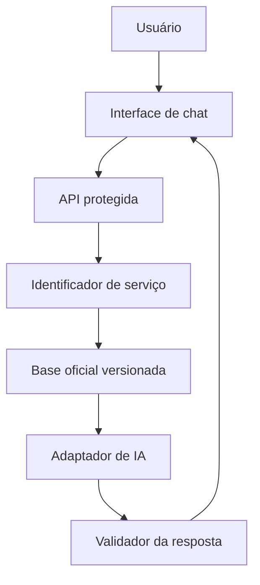

# Arquitetura do MVP

## Visão geral



## Componentes

| Componente | Responsabilidade |
|---|---|
| Interface | Exibir conversa, fontes e checklist; manter somente o estado da sessão. |
| API | Validar entrada, limitar requisições, orquestrar consulta e ocultar a chave. |
| Registro de serviços | Relacionar identificadores, nomes, siglas, termos equivalentes e pastas de conteúdo. |
| Base oficial | Armazenar roteiro, documentos, perguntas frequentes e fontes validadas. |
| Adaptador de IA | Encapsular a chamada ao Gemini e permitir troca futura de provedor. |
| Validador | Rejeitar resposta sem fonte, serviço ou suporte nos trechos recuperados. |

## Fluxo da resposta

1. A API recebe a mensagem e um histórico curto da sessão.
2. Valida tamanho e formato da entrada.
3. Identifica o serviço por termos cadastrados e, quando necessário, com classificação da IA.
4. Recupera somente o conteúdo validado do serviço.
5. Monta uma instrução com a pergunta, os trechos e as regras do assistente.
6. O provedor gera uma resposta estruturada.
7. O servidor valida serviço, fontes e tipo de resposta.
8. A interface exibe o texto, as fontes e, quando solicitado, o checklist.

## Contrato inicial da API

### `POST /api/chat`

Entrada:

```json
{
  "message": "Quero saber como solicitar uma LAC",
  "history": []
}
```

Saída:

```json
{
  "status": "answered",
  "serviceId": "lac",
  "answer": "...",
  "sources": [],
  "checklistAvailable": true
}
```

Estados previstos: `answered`, `clarification_needed`, `not_available` e `error`.

## Estrutura da base

```text
services/
├── registry.json
├── schemas/
│   ├── registry.schema.json
│   └── service.schema.json
└── lac/
    └── versoes/
        └── v1/
            ├── versao.json
            ├── service.json
            ├── roteiro.md
            ├── documentos.json
            ├── perguntas-frequentes.json
            ├── fontes.json
            └── conteudo-assistente.json
```

### Como a base é organizada

- **Registro central:** `registry.json` lista os serviços (identificador, `assuntoId`, `versaoAtualId`, `versaoPublicadaId`, caminho do `service.json` da versão atual, status e publicação).
- **Arquivos por serviço e por versão (Passo 7C2):** cada serviço tem pasta própria e o conteúdo fica na pasta da versão, `services/<id>/versoes/v<número>/`, em arquivos modulares separados (dados, roteiro, documentos, perguntas frequentes, fontes e conteúdo do assistente), mais o manifesto `versao.json`. O conteúdo não é reunido em um único JSON, e nada fica solto na raiz de `services/<id>/`. A LAC tem só a versão 1 (`lac-v1`), em **rascunho**, migrada sem alteração material, sem hash, sem envio, sem decisão e sem versão publicada (`versaoPublicadaId: null`). O validador confere versão atual existente, `servicoId`, id e número coerentes, caminhos dentro da pasta da versão, arquivos existentes, ausência de arquivos soltos ou de pastas de versão não registradas e que `versaoPublicadaId` só aponte para versão em estado publicado. O assistente em teste local (`services/assistant-endpoint.js`) localiza a versão atual pelo registro e pelo manifesto (`services/versao-atual.js`), sem caminho fixo da LAC. Os status atuais de serviço, fontes, documentos e perguntas não mudaram.
- **Relação por `fonteId`:** documentos e perguntas apontam para uma fonte de `fontes.json` pelo `fonteId`; `links` e `legislacao` do `service.json` listam identificadores de fontes.
- **Tipos de links oficiais:** `legislacao`, `pagina_oficial`, `manual`, `formulario`, `sistema`, `canal_atendimento` e `outro`.
- **HTTPS:** toda URL cadastrada deve usar `https://` e não pode se repetir.
- **Sem acesso automático:** `npm run validate:services` confere apenas o formato; nenhum link é acessado nem baixado.
- **Bloqueio de conteúdo:** serviço ou fonte em `rascunho` ou `em_validacao` não pode ser publicado, e em `rascunho` o conteúdo material fica `PENDENTE`.
- **Origem oficial não é validação:** cada fonte tem `origemOficial` (a fonte pertence a órgão público ou instituição oficial), `statusValidacao` (`rascunho`, `em_validacao` ou `validado`) e `publicado`. Uma fonte oficial em `em_validacao` continua sem poder orientar respostas; `publicado` só pode ser `true` com status `validado`.
- **Vigência jurídica:** cada fonte tem `vigencia` com `situacao` (`vigente`, `alterada`, `revogada`, `a_confirmar` ou `nao_se_aplica`), `normasRelacionadas` (ids de fontes do mesmo `fontes.json`) e `observacao`. Legislação não usa `nao_se_aplica`; as demais fontes usam somente `nao_se_aplica`; norma `revogada` cita ao menos uma norma relacionada.
- **Normas revogadas:** podem ficar registradas como histórico, mas nunca podem ser publicadas nem orientar respostas. Norma com vigência `a_confirmar` também não pode ser publicada. Um serviço publicado só pode referenciar fontes validadas, publicadas e não revogadas.
- **Validar a fonte não é publicar:** `statusValidacao: validado` em uma fonte significa que ela foi localizada, pertence ao órgão indicado e teve título, URL e metadados conferidos. Não confirma vigência, atualização do conteúdo nem autorização para responder ao cidadão; por isso as fontes validadas continuam com `publicado: false`. O conjunto `fontes.json` permanece `em_validacao`, pois ainda pode receber novas fontes.
- **Fontes documentais e normas:** manuais, termos de referência e perguntas e respostas ficam em `links` do serviço, nunca em `legislacao`. Uma fonte não legislativa mantém `vigencia.situacao: nao_se_aplica` e pode citar em `normasRelacionadas` apenas fontes do tipo `legislacao` existentes no mesmo arquivo.
- **Serviço em validação:** com `statusValidacao: em_validacao`, o serviço pode ter conteúdo cadastrado, mas continua `publicado: false`. Todo campo preenchido (`descricao`, `publico`, `condicoes`, `etapas`, `sistemaInicio`, `canalAtendimento`) indica suas fontes em `referencias` por `fonteId`, e cada seção do `roteiro.md` com conteúdo traz uma linha `Fontes:` com ids existentes. Fonte revogada não pode ser citada como fundamento.
- **Checklist de documentos:** os 28 itens de `documentos.json` foram transcritos do TR nº 176 (2020), com `fonteId`, `localizacaoFonte` (numeração do TR), `aplicabilidade` e `condicional`. Todos estão `em_validacao`, `publicado: false` e `revisaoAtualidade: pendente`. `obrigatorio: null` significa que a obrigatoriedade atual **não foi confirmada** (não é dispensa); `true` ou `false` só são aceitos após revisão de atualidade concluída e validação. `condicional` reflete a condição descrita no TR de 2020, e não uma confirmação atual: `condicional: false` significa apenas que o TR não apresentou condição expressa naquele item, sem confirmar que o documento seja hoje obrigatório (isso é representado por `obrigatorio`). Inconsistências e possíveis sinais de desatualização do TR ficam em `alertas`, campo sempre presente: lista vazia quando não há inconsistência específica e, quando há problema identificado, um ou mais textos não vazios. O conteúdo não está disponível ao assistente: só item publicado, validado, com revisão concluída e fonte publicada e não revogada passa pelo filtro.
- **Perguntas frequentes:** as 21 perguntas de `perguntas-frequentes.json` foram transcritas do FAQ de 2022 em linguagem de fonte histórica ("O FAQ de 2022 informa que…"). `conteudoFonte` é só registro da fonte e **nunca** é usado pelo assistente; somente `respostaPublicavel`, aprovada e publicada, poderá ser usada. Todas estão `em_validacao`, `publicado: false`, `revisaoAtualidade: pendente` e `respostaPublicavel: null`. `bloqueios` usa valores controlados (desatualizacao, vigencia, informacao_variavel, fonte_complementar, conflito_com_base, contato_desatualizado, procedimento_do_sistema, enquadramento_dependente_de_analise); pergunta publicada não pode ter bloqueios. Contatos (e-mails e telefones) não são armazenados: o validador rejeita esses dados e o FAQ registra apenas que há um contato institucional a atualizar. As observações a até h do FAQ não foram cadastradas e ficam para a revisão do Passo 4.
- **Conteúdo do assistente por ambiente:** `conteudo-assistente.json` guarda blocos de conteúdo, cada um com `ambiente` (`teste_local` ou `publico`), `origem` (`fonte` ou `regra_institucional`) e as mesmas marcas de validação e publicação. O teste local é uma condição **separada** de `publicado`: bloco `teste_local` nunca é `publicado: true` nem `validado`, e a autorização de teste (`autorizacao`, escopo `teste_local`, `aprovacaoMaterial: false`, `aprovacaoPublica: false`) não é aprovação material nem pública. O validador impede, em bloco de teste, valores, prazos, validade, normas, obrigatoriedade documental, canal de protocolo e contatos.
- **Seleção por modo:** a função pura `selecionarBlocosAssistente(dados, modo)` (`services/assistant-content.js`) recebe os dados e o modo explicitamente. O modo padrão é `publico`: só entrega bloco publicado, validado, com revisão concluída e fontes publicadas e não revogadas, o que hoje resulta em zero blocos. O modo `teste_local` entrega somente os blocos de teste, e apenas com autorização válida. Modo desconhecido é rejeitado. A função não lê arquivos nem variáveis de ambiente. Documentos e perguntas não passam por ela.
- **Assistente em teste local (Passo 6):** o endpoint `GET /__assistente/blocos` (`services/assistant-endpoint.js`, registrado em `vite.config.js` com `apply: 'serve'`) existe somente no servidor de desenvolvimento. Ele usa `selecionarBlocosAssistente(..., 'teste_local')` com o modo fixo no servidor, aceita só `GET`, só de origem local, recusa qualquer parâmetro e não recebe nem repete a pergunta. Entrega os blocos, as fontes (somente `https`) e as mensagens fixas (`services/assistant-messages.js`: faixa de teste e frase de escopo), que ficam no servidor e não no código da interface. A interface (`src/main.js`) busca o endpoint só quando `import.meta.env.DEV` é verdadeiro, valida a resposta (`validarPayload`) e usa `src/assistant.js` para reconhecer a intenção e montar a resposta **no navegador, palavra por palavra a partir dos blocos**. Sem blocos, a resposta é a mensagem segura de indisponibilidade. O DOM é montado com `textContent` (sem `innerHTML`), links só `https`, e a conversa fica em memória, sem gravação no navegador. `scripts/check-dist.js` confere que o build não contém blocos, frase de escopo, faixa nem nomes internos. Uma IA externa, no futuro, só poderia rodar no servidor, com a chave em variável de ambiente do servidor, recebendo apenas os blocos selecionados e com a saída validada.
- **Assunto e serviço (Marco 7, Passo 7A):** são conceitos distintos. **Assunto** é uma área ampla da SEMA e fica em `services/assuntos.json` (esquema `schemas/assuntos.schema.json`); **serviço** é um atendimento específico e continua cadastrado em `services/registry.json` e em `services/<id>/service.json`, com `assuntoId` apontando para um assunto **existente e ativo**. O `assuntoId` precisa ser igual no registro e no `service.json`. Hoje há um assunto, "Licenciamento Ambiental", e a LAC está vinculada a ele. O campo `categoria` do serviço segue como texto livre.
- **Fluxo de versões (modelo, ainda não aplicado):** `services/admin/fluxo.js` define os seis estados que pertencem à **versão** de um serviço (`rascunho`, `em_validacao`, `ajustes_solicitados`, `validado_materialmente`, `autorizado_publicacao`, `publicado`) e as transições válidas, em funções puras. `services/admin/hash.js` calcula o SHA-256 determinístico do conteúdo (chaves normalizadas), para provar qual conteúdo foi validado. **O fluxo ainda não foi aplicado à LAC**: os status atuais de serviço, fontes, documentos e perguntas (`rascunho`, `em_validacao`, `validado`) não mudaram, o conteúdo da LAC não foi migrado para versões, e **não há validação material nem publicação autorizada**. Não existe interface, endpoint nem armazenamento administrativo nesta fase.
- **Versões e decisões (Passo 7B, funções puras):** `services/admin/versao.js` e `services/admin/decisoes.js` implementam o fluxo da versão sobre `fluxo.js` e `hash.js`. A versão guarda só **referências** aos arquivos modulares (`arquivos`), mais `estado`, `numero`, `baseadaEm`, `hashConteudo`, `criadoEm` e `enviadaEm`; o conteúdo é entregue apenas para calcular o hash. Regras: enviar para validação calcula o hash; a decisão material (`ajustes_solicitados`, com observação obrigatória, ou `validado_materialmente`) exige o mesmo `versaoId` e o mesmo hash; a autorização de publicação é uma decisão separada, só depois da validação material do mesmo hash; a publicação só depois da autorização do mesmo hash; a partir de `em_validacao` a versão fica congelada; nova versão (rascunho, número seguinte, `baseadaEm`) só a partir de ajustes, validada, autorizada ou publicada, preservando a anterior. O histórico só recebe acréscimos (sem editar, apagar ou reordenar) e recusa id duplicado. Ids e datas vêm de fora das funções, e os objetos recebidos nunca são modificados. Esquemas: `schemas/versao.schema.json`, `schemas/decisao-material.schema.json` e `schemas/autorizacao-publicacao.schema.json`. **Nenhuma versão, decisão ou validação material real foi registrada**; `responsavel` e `unidade` são identificadores de registro, sem valor de comprovação de identidade, e decisões com identificação pessoal continuarão fora do Git. Ainda não há migração da LAC, armazenamento, endpoint nem interface.
- **Armazenamento local (Passo 7C1):** `services/admin/armazenamento.js` lê JSON, grava JSON de forma atômica, acrescenta registros a um histórico JSONL e o lista, dentro de uma raiz recebida explicitamente. Valida os dados com função do chamador antes de gravar, usa formato determinístico (UTF-8, chaves ordenadas, quebra de linha final) e recusa caminho absoluto, `..`, byte nulo, saída da raiz, links simbólicos, extensões não permitidas e id duplicado; o histórico só aceita acréscimos. Não usa `localStorage`, rede nem variáveis de ambiente, e **ainda não é usado por nenhum endpoint ou interface**. Os dados privados ficarão em `data/admin-private/`, no `.gitignore`. Detalhes e limites (sem autenticação, sem comprovação de identidade) em [ADMINISTRACAO.md](ADMINISTRACAO.md).
- **Endpoint administrativo local de leitura (Passo 7D):** `services/admin/admin-endpoint.js`, registrado em `vite.config.js` com `apply: 'serve'` (só no `npm run dev`; não existe no build nem no preview). Rotas `GET /__admin/sessao`, `/__admin/catalogo` e `/__admin/servicos/<id>/versao-atual`, com token em memória (`node:crypto`) no cabeçalho `X-Admin-Token`, validação de conexão local, `Host` e `Origin`, sem CORS, `Cache-Control: no-store`, só `GET`, sem query nem corpo, erros genéricos e limite de resposta. Reutiliza `armazenamento.js` e `versao-atual.js`, não grava nada e não lê dados privados. O `check-dist` passou a procurar nomes e conteúdo administrativos no `dist/`. Ainda não há interface administrativa. Detalhes em [ADMINISTRACAO.md](ADMINISTRACAO.md).
- **Cadastro administrativo (Passo 7E1):** `POST /__admin/assuntos` e `POST /__admin/servicos` no mesmo endpoint de desenvolvimento, com token, origem local, `Content-Type: application/json`, corpo de até 32 KB e somente os campos permitidos. Funções puras (`services/admin/cadastro.js`) montam o assunto e o esqueleto do serviço (versão 1, rascunho, não publicado, tudo `PENDENTE`, sem conteúdo inventado); `services/admin/transacao.js` aplica a alteração como uma só (ensaio em cópia temporária, escrita atômica pelo armazenamento, conferência pelo validador e desfazer integral em caso de falha). Uma gravação por vez (409 se houver outra em andamento). O `armazenamento.js` ganhou `lerTexto` e `gravarTexto` para `.md`. Ainda não há interface, edição, decisão, publicação nem exclusão. Detalhes em [ADMINISTRACAO.md](ADMINISTRACAO.md).
- **Interface administrativa (Passo 7E2):** a pasta `admin/` (`index.html`, `styles.css`, `admin.js` e `admin-logic.js`) é a tela "Gestão de conteúdo", servida pelo Vite só em desenvolvimento (`http://localhost:5173/admin/`; um plugin com `apply: 'serve'` redireciona `/admin`). O build usa apenas o `index.html` da raiz, então `admin/` não entra no `dist/`, e `check-dist` confere isso. `admin-logic.js` concentra as funções puras (validação dos formulários, agrupamento do catálogo, mensagens de erro) e um cliente do endpoint com `fetch` injetável, que guarda o token só em memória e impede envio duplicado; `admin.js` apenas liga isso ao DOM, sem `innerHTML` nem armazenamento do navegador. A interface do cidadão não referencia a administração. Detalhes em [ADMINISTRACAO.md](ADMINISTRACAO.md).
- **Cadastro de fontes por serviço (Passo 7E3A):** `POST /__admin/servicos/<id>/fontes` acrescenta uma fonte ao arquivo de fontes da versão atual, só quando ela está em `rascunho` e com revisão otimista: `GET .../versao-atual` devolve `revisaoFontes` (SHA-256 do conteúdo) e o `POST` a exige (409 se divergir). Campos de status, publicação, data de consulta e vigência são definidos pelo servidor: a fonte nasce em rascunho, não publicada, com vigência `a_confirmar` (legislação) ou `nao_se_aplica`. Reaproveita a transação (ensaio, escrita atômica, conferência, desfazer) e a trava de escrita. A tela ganhou a seção "Fontes do serviço", sem editar, excluir, validar ou publicar. Detalhes em [ADMINISTRACAO.md](ADMINISTRACAO.md).
- **Cadastro simplificado (Passo 7E3B):** o id de assunto e de serviço é gerado pelo servidor a partir do nome (`baseDoId` e `gerarId`, em `services/admin/cadastro.js`: minúsculas, sem acentos, hífen, começando por letra, com prefixo `item-` se começar por número), uma única vez, com colisão resolvida por sufixo determinístico (`-2`, `-3`...) sem sobrescrever registros. O cliente não envia id (campo extra, 422). A tela não mostra ids nem ids de versão: o catálogo de exibição (`agruparCatalogo`) traz só nome, descrição, sigla, situação amigável e publicação. A estrutura técnica (ids, versões, hashes, caminhos) segue nos arquivos internos e na API de consulta. Dados existentes inalterados.
- **Saúde do sistema (Passo 8B):** `GET /__admin/saude` (só no servidor de desenvolvimento, com as proteções do endpoint administrativo) executa `verificarSaude` (`services/admin/saude.js`) e devolve, por componente, capacidade (`implementado`, `nao_implementado`, `nao_se_aplica`) e estado (`operacional`, `degradado`, `indisponivel`, `nao_verificado`) separados, com horário ISO e mensagem pública fixa. As verificações são reais: aplicação, base (validador), armazenamento (teste temporário fora dos dados reais) e contagem de conteúdo publicado; banco, IA externa e processamento de fontes constam como não implementados (MCP não faz parte da saúde operacional). O resumo conta os estados só entre os componentes implementados e traz a contagem separada de não implementados. A interface é a página `/admin/saude/` (`admin/saude/`), separada de `/admin/`, que reutiliza a lógica e o token de `admin/admin-logic.js`. Nada disso entra no build. Detalhes em [ADMINISTRACAO.md](ADMINISTRACAO.md).
- **Testes de ponta a ponta (Passo 8C):** `e2e/` e `playwright.config.js` (`@playwright/test`, devDependency, só Chromium) executam 13 testes somente leitura contra o servidor de desenvolvimento (porta 5173 estrita, sem `--host`), com bloqueio de requisições que não sejam GET e de rede externa. A gestão de conteúdo (`/admin/`) e a saúde (`/admin/saude/`) são páginas separadas; recursos não implementados (banco, IA externa, processamento de fontes) são apresentados como não implementados, não como falhas. `e2e/`, `playwright-report/` e `test-results/` não entram no build.
- **Uso pelo assistente:** somente fontes validadas e publicadas poderão ser utilizadas. O registro da situação de vigência não substitui a conferência pela área competente.
- **Novos serviços:** entram pelo mesmo caminho, com uma pasta em `services/` e uma entrada no registro, sem alterar o fluxo principal.

## Decisões de segurança

- `GEMINI_API_KEY` existe somente no ambiente da função serverless;
- nenhuma chamada direta ao Gemini parte do navegador;
- mensagens e histórico não são gravados;
- logs não devem registrar o conteúdo integral da conversa;
- erros públicos não exibem prompt, chave, resposta bruta ou detalhes internos;
- apenas conteúdo `validado` participa da recuperação;
- limites de tamanho e frequência serão aplicados na API.

## Evolução

Novos serviços serão incluídos no registro e em pastas próprias. Banco de dados, busca vetorial, autenticação e integrações institucionais só serão avaliados depois que o MVP comprovar a necessidade.

## MCP local de consulta da base (Sprint 2)

Ferramenta de apoio ao desenvolvimento, fora da aplicação: `.mcp.json` inicia `scripts/mcp/` (`npm run mcp`), com quatro ferramentas somente leitura (`listar_assuntos`, `listar_servicos`, `consultar_fontes`, `resumir_base`) sobre a base em `services/`. Não é endpoint do chat, não consta da saúde do sistema, não existe no `dist/` e não torna o conteúdo da LAC público. Evidências em `docs/EVIDENCIAS_MCP.md`.

## Blocos de conhecimento (Sprint 3)

- **Modelo:** bloco do tipo `conhecimento` no vetor `blocos` de `conteudo-assistente.json` de cada versão (fonte única de verdade, versionada e congelada com a versão). Campos: `id` (gerado pelo servidor), `titulo`, `texto`, `origem: fonte`, `fonteIds`, `referencias` (`{ fonteId, localizacao }`, uma por fonte), `alertas` opcionais, `ambiente`, `statusValidacao`, `publicado`, `revisaoAtualidade`, `criadoEm` e `atualizadoEm`. Identidade auditável: `versaoId + blocoId`.
- **Regras:** `scripts/validate-services.js` (`validarBlocoConhecimento`) e `services/schemas/service.schema.json` aceitam só combinações coerentes de estado, revisão e publicação, com limites de tamanho, referências correspondentes aos `fonteIds` e datas AAAA-MM-DD. `services/admin/conhecimento.js` reúne as funções puras (montar, alterar, remover e preparar blocos para nova versão); o id e as datas vêm de fora e as entradas nunca são modificadas.
- **Endpoints e tela:** `/__admin/servicos/<id>/conhecimentos` (POST, PATCH e DELETE) em `services/admin/admin-endpoint.js` e a página `admin/conteudo/`, ambos só no servidor de desenvolvimento, com a mesma transação e a mesma trava de escrita do cadastro.
- **Assistente:** `selecionarBlocosAssistente` só entrega conhecimento publicado, validado, com revisão concluída, fontes publicadas e não revogadas, origem `fonte`, `fonteIds` não vazio e referências correspondentes. O bloco nasce em rascunho e não publicado, então não chega ao chat. O chat público não foi alterado.
- **Build:** `scripts/check-dist.js` procura no `dist/` a rota e os textos da página, os endpoints `/conhecimentos` e os módulos administrativos de conhecimento, com termos específicos que não existem no chat público.

## Entradas de texto (Sprint 4, Passo 4B1)

- **Arquivo:** `entradas.json` por versão, ao lado de `fontes.json` (`services/<serviço>/versoes/vN/`), com `{ servicoId, entradas: [{ id, fonteId, texto, hash, criadoEm, atualizadoEm }] }`. Só existe se `arquivos.entradas` estiver no manifesto `versao.json` (caminho `<pasta da versão>/entradas.json`); serviço novo nasce com o arquivo vazio. Documentado em `services/schemas/entradas.schema.json`.
- **Texto:** simples, preservado exatamente como enviado; `hash` = SHA-256 dos bytes UTF-8 do texto, só em `entradas.json`. Limites: 20.000 caracteres e 80.000 bytes por entrada; 100.000 caracteres e 400.000 bytes por versão. Recusa texto vazio, controles C0 (exceto tabulação, quebra de linha e retorno de carro), e-mail, telefone e credencial. Erros trazem só códigos e nomes de campos, nunca o texto.
- **Fontes:** campo novo `formaEntrada: "link" | "texto"` (ausente = `link`; as fontes atuais da LAC não foram migradas). Fonte textual: `formaEntrada "texto"`, `entradaId`, `url: null`, tipo `texto_cadastrado`, `origemOficial false`, rascunho, não publicada, sem `verificacaoOrigem`; correspondência 1:1 com a entrada. Links seguem com URL https única e sem `entradaId`; a unicidade de URL vale só entre links.
- **Código:** `services/admin/entradas.js` (funções puras: validar corpo, montar entrada e fonte, validar o arquivo e a associação, copiar para nova versão) e `services/admin/entradas-gravacao.js` (uma só transação com `entradas.json`, `fontes.json` e, na primeira entrada, `versao.json`; verificação final por `validarServicos`, trava e desfazer total). Sem rota HTTP neste passo; só versão em rascunho é alterada.
- **Isolamento:** o chat, o assistente (que também exclui fontes textuais), o servidor MCP e o `dist/` não leem nem contêm `entradas.json` nem o texto cadastrado (`scripts/check-dist.js` procura o arquivo, os módulos e os textos). O texto não chega ao chatbot antes de revisão, autorização e publicação.
- **Pendências explícitas:** (1) o hash da versão (Sprint 5) precisa incluir o `entradas.json`; hoje `hashConteudo` segue null em elaboração e o arquivo não entra em nenhum hash. (2) `copiarEntradasParaNovaVersao` ainda não está ligada a nenhum fluxo de nova versão. (3) Ao ligar a rota (4B2), a trava do gravador deve ser a mesma das demais escritas administrativas.
- **Assunto:** `descricao` passou a ser opcional (omitida, nunca `PENDENTE`).

### Reutilização de links entre serviços (Passo 4B1, correção)

- **Escopo:** só links (`formaEntrada` "link" ou ausente), com `statusValidacao` validado e vigência não revogada, nas **versões atuais de outros serviços**. Publicação não é exigida, porque a cópia passa por nova revisão. Fonte textual **nunca** é reutilizável (na futura interface: "Usar link já cadastrado").
- **Busca:** `buscarLinksReutilizaveis` (`services/admin/reutilizacao.js`) é somente leitura e nunca altera o serviço de origem.
- **Cópia:** `criarCopiaDeLink` é função pura (ainda não gravada por nenhuma rota). Cria fonte nova com id novo, URL preservada e só metadados estáveis (título, tipo, órgão, descrição, `origemOficial` como procedência, `dataPublicacao`, `dispositivoRelevante`). **Reinicia:** `statusValidacao` "rascunho", `publicado` false, `dataConsulta` null e vigência (`a_confirmar` em legislação, `nao_se_aplica` nos demais; sem normas nem observação). Não herda validação, decisão nem autorização.
- **Linhagem:** `reutilizadaDe: { servicoId, versaoId, fonteId }` (opcional, só em link; validador e `service.schema.json`). Em cópia de cópia, registra a fonte efetivamente selecionada; nenhuma fonte anterior é alterada. A URL continua única dentro de cada serviço.
- **MCP:** `consultar_fontes` omite por completo fonte textual não publicada (título, descrição, id, filtros e totais); o texto original nunca é lido. Não houve ampliação de ferramentas nem de permissões.
- **Limitações:** a cópia não é gravada (a rota e a interface são do 4B2); `reutilizadaDe` de uma cópia não acompanha mudanças posteriores da origem; `resumir_base` ainda conta fontes textuais nos totais (só números).
- **Sprint 5:** o bloqueio das fontes textuais no assistente é provisório. Blocos revisados e publicados derivados de texto poderão fundamentar respostas; o assistente usará os blocos publicados, nunca `entradas.json`; o texto original continua isolado; respostas apoiadas só em texto cadastrado não mostram fonte; respostas apoiadas em link mostram somente os links usados.

## Gestão simples por serviço (Sprint 4, Passo 4B2)

A administração local passou a ser orientada por serviço (`admin/`: `index.html`, `admin.js`, `admin-logic.js`, `styles.css`; `conteudo/` e `saude/` são páginas separadas). Rotas novas em `services/admin/admin-endpoint.js` (`servico-com-tema`, `informacoes`, `entradas-texto`, `links`, `links-existentes` e `/busca`), validações em `services/admin/gestao-simples.js`, texto em `entradas.js` e `entradas-gravacao.js` e reutilização em `reutilizacao.js`. Todas as gravações usam a mesma trava e a transação com ensaio e rollback; o cliente nunca envia ids a gravar nem o objeto de uma fonte. A entrada de demonstração não é autenticação. Nada é publicado e o chat não lê `entradas.json`. Detalhes em `docs/ADMINISTRACAO.md` e evidências em `docs/EVIDENCIAS_SPRINT_4.md`.

## Domínio da versão: hash, congelamento e nova versão (Sprint 5, Passo 5A)

Funções e módulos (sem rotas, interface, histórico, autorização, publicação nem mudança no chatbot):

- **Hash canônico** (`services/admin/conteudo-versao.js`, `versao-arquivos.js`): chaves lógicas `service`, `roteiro`, `documentos`, `perguntasFrequentes`, `fontes`, `conteudoAssistente` e `entradas` (quando o manifesto a referencia). JSON com chaves ordenadas; roteiro com CRLF e CR normalizados para LF, sem aparar; ficam fora `versao.json`, `hashConteudo` e os metadados do manifesto; fica fora apenas o campo `publicado` (em qualquer nível dos arquivos JSON). Status de validação e de revisão entram no hash. A leitura é confinada à pasta da própria versão (caminhos do manifesto exatamente iguais aos esperados).
- **Congelamento** (`congelamento.js`): "concluir a revisão" calcula o hash e leva a versão de `rascunho` a `em_validacao` (não editável). Grava só o `versao.json`, numa transação com conferência da base inteira.
- **Nova versão** (`nova-versao.js`): pasta nova, arquivos copiados de forma independente com os caminhos da própria pasta (inclusive os internos do `service.json`), `entradas.json` copiado, manifesto em `rascunho` sem hash, `publicado` falso, revisão de atualidade pendente, o que estava `validado` volta a `em_validacao` e blocos de conhecimento voltam a `rascunho`. O registro é o último passo da transação e passa a apontar a nova versão como atual; sem versão publicada, o registro acompanha o `service.json` novo; com versão publicada, `versaoPublicadaId` e o status do registro continuam descrevendo a publicada. A versão anterior fica intacta.
- **Validador** (`scripts/validate-services.js`): confere o hash gravado com o conteúdo (versão atual, publicada e anteriores); aceita `versaoPublicadaId` apontando para uma versão anterior (publicada, com hash coerente) enquanto a atual está em elaboração; versões anteriores à atual ficam preservadas, e pastas de número maior que o da atual continuam erro; a equivalência registro × `service.json` só vale quando a atual é a publicada (ou nada foi publicado).
- **Tabela de ações** (`services/admin/fluxo.js`, `ACOES_DA_VERSAO`): concluir revisão, solicitar ajustes, validar materialmente, autorizar publicação, publicar e nova versão, cada uma nos estados em que é permitida. Revisão e autorização são ações separadas, e nenhuma ação de revisão leva direto a `publicado`.

Observações e pendências registradas para a 5B e a 5C:

- O status `rascunho` do serviço e dos arquivos é o esqueleto vazio (o validador exige conteúdo `PENDENTE`); por isso a nova versão não usa `rascunho` para conteúdo copiado.
- As entradas de `entradas.json` não têm status nem `publicado`; a fonte textual correspondente é reiniciada junto com as demais fontes.
- O campo `publicado` fica fora do hash, então a conferência do hash não protege essa flag depois do congelamento. **Pendência 5C:** o gerador público deve ignorar `publicado` dos arquivos e decidir pelo estado do manifesto da versão publicada.
- **Roteiro copiado byte a byte:** a nova versão grava o `roteiro.md` com `gravarTextoExato` (passo `texto_exato` da transação), sem aparar espaços, sem acrescentar ou remover quebra de linha e sem converter CRLF/LF. A normalização de CRLF e CR para LF existe somente na representação canônica do hash. A transação ainda confere, byte a byte, que o roteiro novo é idêntico ao da origem; se divergir, tudo é desfeito.
- **`em_validacao` em fonte e conteúdo copiados:** o que estava `validado` volta a `em_validacao` na versão nova. Isso significa que a fonte (ou o conteúdo) precisa passar de novo por validação; nenhuma validação material é herdada. A versão nova permanece em rascunho e a interface a mostrará como "Em elaboração".
- Se `service.arquivos` tiver a chave `entradas`, a criação da nova versão recusa (`conteudo_invalido`); a LAC não a tem.
- Cada operação grava uma coisa por vez; a trava comum entre rotas fica para a 5B, quando houver rotas.

## Revisão humana da versão (Sprint 5, Passo 5B1)

Domínio, rotas e histórico, **sem interface e sem publicação** (a interface é o 5B2, dentro de `/admin/`).

- **Regras** (`services/admin/revisao.js`, puras): revisar fonte (marca como validada, com `dataConsulta`; não publica, não altera `origemOficial`, não acessa o link, sem agente nem IA; recusa fonte revogada, inexistente ou de outra versão); aceitar bloco de conhecimento (versão atual em rascunho, bloco em elaboração, pelo menos uma fonte, todas existentes, revisadas e não revogadas; passa a validado com revisão concluída e `publicado` falso; `entradas.json` intocado); rejeitar bloco (remove só bloco de conhecimento em rascunho; fonte e entrada ficam); pendências (`sem_bloco_aceito`, `bloco_pendente`, `fonte_pendente`, `fonte_revogada`, `fonte_inexistente`, `entrada_invalida`). Blocos `teste_local` e os demais tipos não participam. A fonte textual pode ser revisada (validada), mas continua sem publicação.
- **Concluir revisão** (`revisao-servico.js`): só com pelo menos um bloco aceito, nenhum bloco de conhecimento pendente, fontes referenciadas revisadas e não revogadas, entradas íntegras (hash e 1:1) e base válida. Numa única transação: confere de novo, monta o conteúdo canônico, calcula o hash, registra a decisão material (`decisoes.js`), congela (grava `hashConteudo`), leva a versão a `validado_materialmente` ("Pronto para publicar") e valida a base. **Não autoriza nem publica.** Depois disso nada é editável: qualquer alteração exige nova versão.
- **Revisão otimista:** toda ação recebe `revisao`, o hash canônico do conteúdo que a pessoa viu (devolvido pela consulta); conteúdo diferente é recusado (`revisao_divergente`).
- **Histórico privado** (`historico-revisao.js`): `data/admin-private/revisao/<serviço>.jsonl` (ações) e `data/admin-private/decisoes/<serviço>.jsonl` (decisões de `decisoes.js`), só acréscimo. Cada ação guarda serviço, versão, hash, ação, data e hora, resultado e o ator fixo "Servidor de demonstração" (unidade "Ambiente local de demonstração"), nunca conteúdo, texto original, token, caminho, e-mail nem nome. Fora do Git, do MCP, do assistente, do build e do `dist/`. O registro é acrescentado dentro da conferência final da transação: se não puder ser gravado, a base volta ao que era. Uma decisão já gravada por tentativa desfeita (mesma versão e hash) é reaproveitada na nova tentativa.
- **Rotas** (token, Host e Origin locais, limites de corpo, trava comum): `GET /__admin/servicos/<id>/revisao`; `POST .../revisao/fontes`, `.../revisao/blocos/aceitar`, `.../revisao/blocos/rejeitar`, `.../revisao/concluir` e `.../nova-versao`. Erros são códigos genéricos.
- **Contrato alterado:** a fonte textual agora pode estar `em_validacao` ou `validado` (com `dataConsulta`) depois da revisão humana; `publicado` segue falso. Antes, o validador a exigia em rascunho.
- **Decisão órfã (para o 5C):** uma decisão gravada por tentativa desfeita só é reaproveitada se for exatamente a esperada (tipo, versão, hash, decisão e ator iguais); senão a conclusão falha com `historico_invalido`. O histórico sozinho não prova que a versão foi validada: o 5C precisa checar também o estado e o hash do manifesto da versão.
- **Pendência para o 5C:** hoje só as fontes usadas por blocos de conhecimento precisam estar revisadas; uma fonte em rascunho que nenhum bloco usa não impede a conclusão.
- **Pendências:** a autorização e a publicação são do 5C; o histórico fora da transação do conteúdo (arquivo privado) não é atômico com ela, por isso a gravação do histórico acontece na etapa final da transação.

### Interface da revisão (Sprint 5, Passo 5B2)

A revisão não ganhou página nem seção de navegação: faz parte da mesma experiência "Gestão de conteúdo". Em `/admin/` o painel do serviço mostra a situação (rótulos em linguagem comum: "Em elaboração", "Revisão pendente", "Pronto para publicar"), a contagem de fontes e informações pendentes e a ação "Revisar informações"; em `/admin/conteudo/` ficam a revisão das fontes, a aceitação, a edição, o descarte e a reabertura das informações, a conclusão da revisão (com confirmação própria) e "Criar nova versão para editar". Não há botão de publicação.

Extensão mínima do domínio e das rotas para este passo:
- **Reabrir bloco aceito** (`reabrirBloco` em `revisao.js`; `POST .../revisao/blocos/reabrir`): só enquanto a versão está em rascunho; o bloco volta a rascunho, com revisão de atualidade pendente e `publicado` falso; a ação entra no histórico e a revisão otimista é atualizada. Depois de concluir a revisão não existe (`versao_congelada`).
- **Situação da revisão** (`GET .../revisao`): devolve `rotulo` (nome do estado em linguagem comum), `revisaoPendente`, `resumo` (fontes pendentes, informações pendentes e aceitas) e `podeReabrir` por bloco.
- **Edição de fonte:** não existe rota de edição de fonte; por isso não há "desfazer revisão". Uma fonte revisada só muda por nova versão, que reinicia a validação.

### Contato institucional permitido (Sprint 5, ajuste do 5B2)

O texto informado pode conter e-mail do domínio institucional configurado (`services/admin/contatos-permitidos.js`, configuração única `DOMINIOS_EMAIL_PERMITIDOS`, hoje `sema.mt.gov.br`). O domínio é comparado sem diferença entre maiúsculas e minúsculas e exatamente (um domínio parecido, como `sema.mt.gov.br.exemplo.com`, não vale). E-mails externos ou pessoais, telefones, senhas, tokens e credenciais continuam bloqueados; o endereço nunca é registrado nem repetido em mensagens. A mesma função é usada pelo servidor (entradas, blocos e validador da base) e pela interface local.

### Aparência da administração

A tela não menciona "demonstração" nem exibe faixa de ambiente: o acesso é o botão "Acessar administração" (sem autenticação real) e "Sair". Continuam apenas no código e na documentação: o ator registrado "Servidor de demonstração", a administração local e a ausência de autenticação institucional (a identificação não tem valor jurídico).

## Edição e exclusão de fontes (Sprint 5, Passo 5B3a)

Edição e exclusão **lógica** de textos, documentos e links da versão atual (`services/admin/edicao-fonte.js`, orquestrado por `revisao-servico.js`; rotas `GET`, `PATCH` e `DELETE` em `/__admin/servicos/<id>/fontes/<fonteId>`).

- **Versionamento:** só a versão atual em elaboração é editada; versão revisada, congelada ou publicada nunca é alterada (409 `versao_congelada`) e a alteração exige "Criar nova versão para editar"; a anterior fica intacta.
- **Editar link:** título, URL, órgão que publicou, descrição, data de publicação e localização relevante. **Editar texto:** título e texto original (o hash do texto em `entradas.json` é recalculado). O servidor relê a fonte do disco; o cliente só envia campos permitidos e a revisão otimista (hash canônico). URL repetida entre fontes ativas do serviço é recusada.
- **Reinício:** toda edição devolve a fonte a "Ainda não revisada" (`validado` volta a `em_validacao`, sem `dataConsulta`, `publicado` falso) e **reabre** as informações aceitas que a usam (voltam a "Em elaboração"); o hash congelado deixa de valer porque a versão nunca fica congelada enquanto é editada. Link alterado perde a linhagem de reutilização se a URL mudar.
- **Excluir (lógico):** grava `excluidaEm` (data) na fonte; ela continua no arquivo (histórico preservado) e sai da lista ativa, sem área de itens excluídos, lixeira nem restauração; nunca é usada em novas informações, na reutilização nem pelo assistente, e não conta como pendência. `excluidaEm` é o único campo novo: a revogação por vigência (`vigencia.situacao = revogada`) só vale para legislação e não serve para retirar um link ou texto. A fonte revogada (como o decreto 695/2020 da LAC) aparece como "Revogada" e não é editável nem excluível.
- **Referências:** a exclusão é recusada (nada é removido sozinho) se informação em elaboração ou aceita usar a fonte (a resposta lista só os títulos) ou se conteúdo antigo a citar (`service.json`, documentos, perguntas e blocos de teste).
- **Entre versões:** a exclusão lógica vale nas versões seguintes (a nova versão copia a fonte já excluída, que continua fora das listas ativas); a "lixeira" é preservada por auditoria e pode ser limpa em etapa futura.
- **Segurança:** trava comum, transação com rollback, erros genéricos, histórico privado com as ações `editar_fonte` e `excluir_fonte` (só metadados, sem título, URL nem texto), `DELETE` sem corpo com a revisão no cabeçalho `X-Revisao`. Nada é publicado.

### Temas e serviços (Sprint 5, Passo 5B3b)

Editar o nome do tema (impacto e confirmação; o id é imutável; nome duplicado é recusado; histórico privado em `data/admin-private/temas`, só metadados) e o nome e o tema do serviço na versão em elaboração (reabre as informações aceitas; versão congelada exige "Criar nova versão para editar"). Rotas `GET` e `PATCH` em `/__admin/servicos/<id>/edicao` e `/__admin/temas/<id>/edicao`.

### Importar conteúdo existente (Sprint 5, Passo 5B3c)

Rotas `GET` e `POST` em `/__admin/servicos/<id>/importacao`. Os candidatos são lidos do conteúdo antigo, um item por vez, e cada um cria uma informação em elaboração com fonte ativa. Nunca aceita, revisa nem publica. O campo interno `origemImportacao` do bloco evita duplicação. O conteúdo antigo fica intacto e a LAC real não foi convertida.

### Autorização e publicação (Sprint 5, Passo 5C)

Concluir a revisão, autorizar a publicação e publicar são ações separadas. Rotas: `POST .../autorizacao`, `GET .../publicacao/resumo` e `POST .../publicacao`. A publicação é uma transação única com rollback: o manifesto ganha `publicadoEm` e o registro, `versaoPublicadaId`. O conteúdo público é gravado em `services/<serviço>/publico/conteudo-<hash16>.json`, imutável e de esquema fechado (`services/publicacao-publica.js`; `lerConteudoPublicado` falha de forma segura). O chatbot (`src/assistant.js`, `src/main.js`) e o build (`services/conteudo-publico-build.js`, plugin Vite, saída em `dist/conteudo-publico/`) usam somente o publicado. O `scripts/check-dist.js` é estrito (151 termos). Sem publicação, o chat mantém o comportamento de teste local (conteúdo de teste só no dev, com faixa). Texto cadastrado não mostra fonte; link mostra só a URL. Nenhuma publicação real foi criada.
